<div align="center">

<a href="https://portfolio-git-main-nitesh-sharmas-projects-3b96572d.vercel.app/"></a>

<a href="https://portfolio-git-main-nitesh-sharmas-projects-3b96572d.vercel.app/"></a>
<a href="https://www.linkedin.com/in/nitesh-sharma-5b4115306"></a>
<a href="mailto:niteshsharmans775@gmail.com"></a>
<a href="https://forms.gle/ew34HM4nH6JdGeHv6"></a>

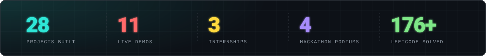

</div>

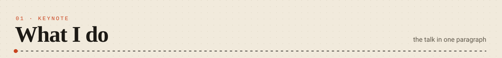

```typescript
const nitesh = {
  now: "Full Stack Developer Intern at Site Guru (since 15 Jun 2026)",
  before: ["Qgenii EdTech (Jul 2025 – Apr 2026)", "Bharati Expoads (Jul – Dec 2025)"],
  studying: [
    "B.Tech CSE, SIET Nilokheri (2023 – 2027)",
    "BS in Data Science and Applications, IIT Madras (ongoing)",
  ],
  completed: "BSc in Programming and Data Science, IIT Madras (May 2026)",
  builds: ["event platforms", "hiring platforms", "multi-tenant SaaS", "real-time video and chat", "AI-assisted tools"],
  openTo: "Full-time roles and freelance projects",
};
```

I start with a messy real-world process (a college running a hackathon on WhatsApp and five spreadsheets, a company tracking its team in chat threads) and turn it into software people actually use. I draw the data and permission model first, then build the whole stack: React or Vue, Node and Express, Postgres, MariaDB or Mongo, with sockets or WebRTC where it needs to feel live. Then I test it hard and ship it.

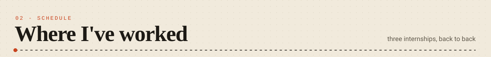



<table>
<tr>
<td width="50%"><a href="https://event-karwalo.vercel.app/"></a><br><sub><a href="https://event-karwalo.vercel.app/">Live demo</a> · private repo</sub></td>
<td width="50%"><a href="https://talentsphere.site.guru">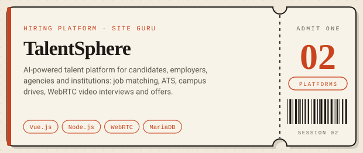</a><br><sub><a href="https://talentsphere.site.guru">Live demo</a> · built at Site Guru</sub></td>
</tr>
<tr>
<td width="50%"><a href="https://ai-hiring-flow.vercel.app/">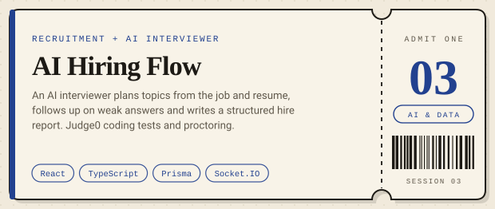</a><br><sub><a href="https://ai-hiring-flow.vercel.app/">Live demo</a> · <a href="https://github.com/NITESHBHARDWAJ001/AI_Hiring_Flow">Source</a></sub></td>
<td width="50%"><a href="https://ai-enabled-health-system.vercel.app/">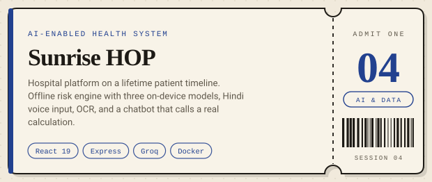</a><br><sub><a href="https://ai-enabled-health-system.vercel.app/">Live demo</a> · <a href="https://github.com/NITESHBHARDWAJ001/AI_Enabled_Health_system">Source</a></sub></td>
</tr>
<tr>
<td width="50%"><a href="https://assert-flow-erp.vercel.app/"></a><br><sub><a href="https://assert-flow-erp.vercel.app/">Live demo</a> · <a href="https://github.com/NITESHBHARDWAJ001/AssertFlowERP">Source</a></sub></td>
<td width="50%"><a href="https://seat-allocation-frontend.vercel.app/">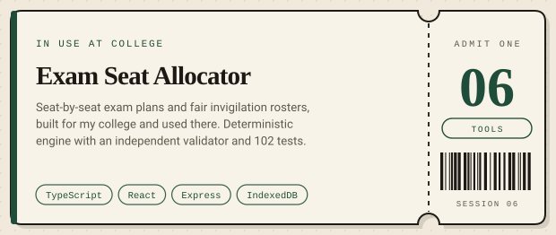</a><br><sub><a href="https://seat-allocation-frontend.vercel.app/">Live demo</a> · <a href="https://github.com/NITESHBHARDWAJ001/Seat_Allocation">Source</a></sub></td>
</tr>
<tr>
<td width="50%"><a href="https://portlify-lemon.vercel.app/"></a><br><sub><a href="https://portlify-lemon.vercel.app/">Live demo</a> · <a href="https://github.com/NITESHBHARDWAJ001/Portlify">Source</a></sub></td>
<td width="50%"><a href="https://github.com/NITESHBHARDWAJ001/AutoFillExtension">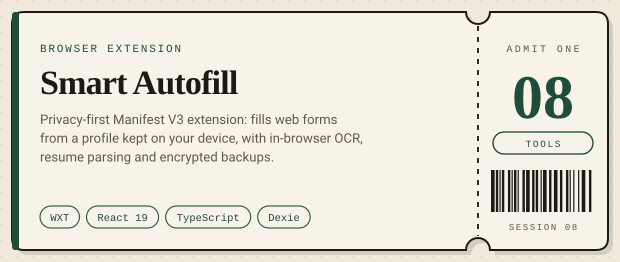</a><br><sub><a href="https://github.com/NITESHBHARDWAJ001/AutoFillExtension">Source</a></sub></td>
</tr>
<tr>
<td width="50%"><a href="https://image-resolution.vercel.app/">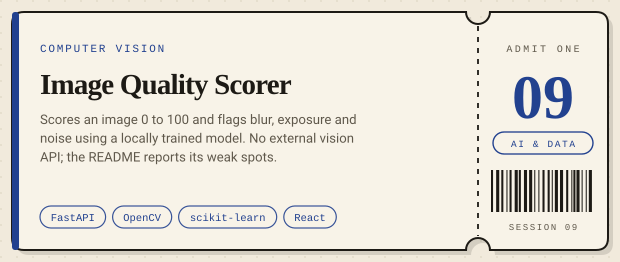</a><br><sub><a href="https://image-resolution.vercel.app/">Live demo</a> · <a href="https://github.com/NITESHBHARDWAJ001/Image_Resolution">Source</a></sub></td>
<td width="50%"><a href="https://lead-flow-liart-rho.vercel.app/"></a><br><sub><a href="https://lead-flow-liart-rho.vercel.app/">Live demo</a> · <a href="https://github.com/NITESHBHARDWAJ001/Lead_Flow">Source</a></sub></td>
</tr>
<tr>
<td width="50%"><a href="https://admin-siet-sih.vercel.app/"></a><br><sub><a href="https://admin-siet-sih.vercel.app/">Live demo</a> · <a href="https://github.com/NITESHBHARDWAJ001/Admin-SIET-SIH">Source</a></sub></td>
<td width="50%"><a href="https://code-crafter-coding-challange.vercel.app">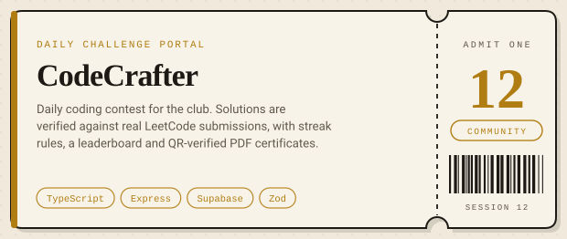</a><br><sub><a href="https://code-crafter-coding-challange.vercel.app">Live demo</a> · <a href="https://github.com/NITESHBHARDWAJ001/CodeCrafter-Coding-Challange">Source</a></sub></td>
</tr>
</table>

<details>
<summary><b>Previous editions: 16 older projects</b></summary>
<br>

| Project | What it is | Stack |
|---|---|---|
| [Smart Campus Portal](https://github.com/NITESHBHARDWAJ001/Smart-Campus-Portal) | College ERP with admin, teacher and student dashboards | MERN |
| [Quiz Master](https://github.com/NITESHBHARDWAJ001/Quiz_Master) | Quiz platform with an admin panel and real-time scoring | Vue.js, Flask |
| [AQI Delhi forecast](https://github.com/NITESHBHARDWAJ001/AQI_Delhi) | XGBoost air-quality prediction with a forecasting dashboard | Flask, React, XGBoost |
| [AI Log Analyser](https://github.com/NITESHBHARDWAJ001/AI_Log_analyser) ([live](https://ai-log-analyser-two.vercel.app)) | Log triage and anomaly detection | React, Node.js |
| [Nature](https://github.com/NITESHBHARDWAJ001/Nature) | Conservation community with NGO verification and chat | MERN, Socket.io |
| [Astrology Management System](https://github.com/NITESHBHARDWAJ001/Astrology) | Kundali generation and a 50-year planetary analysis engine | MERN, Puppeteer |
| [Nursery sales analytics](https://github.com/NITESHBHARDWAJ001/Nursery-Management) | ABC analysis and RFM segmentation for sales optimisation | Python, Pandas |
| [A–Z Household Service](https://github.com/NITESHBHARDWAJ001/A-Z-Household-Service) | Household services and rentals marketplace | Flask, SQLite |
| Operiq ([live](https://software-engg-project-gamma.vercel.app/)) | Multi-service SaaS for ethnic fashion operations | React, TypeScript, FastAPI |
| Crime Analysis system | AI civic platform for crime reporting and geo-mapping | React, Flask, ML |
| AutoQual AI+ and `@hr_71_sharma/agent` | Code-quality monitoring platform and its published npm agent | Node.js, Socket.io |
| EcoFinds, CleanEarth, UIDAI analytics, Cinema forecasting | Smaller marketplace, civic and data-science projects | Flask, React, Python |

</details>


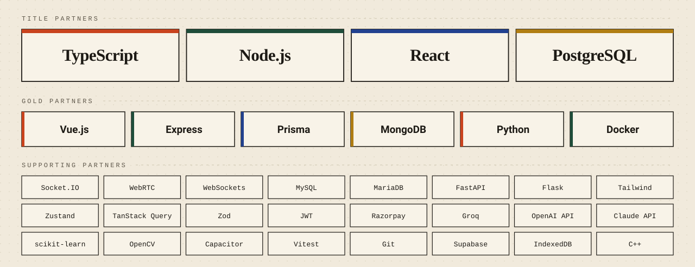


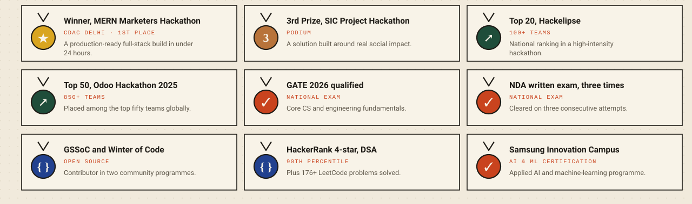

| | |
|---|---|
| **BS in Data Science and Applications** | IIT Madras (online), ongoing |
| **BSc in Programming and Data Science** | IIT Madras (online), completed May 2026 |
| **B.Tech in Computer Science and Engineering** | SIET Nilokheri, 2023 – 2027 |

<div align="center">


</div>


Open to **full-time roles** and **freelance projects**, especially event, hiring and SaaS platforms and AI-assisted tools. The quickest way to reach me is email.

<div align="center">

<a href="mailto:niteshsharmans775@gmail.com"></a>
<a href="https://www.linkedin.com/in/nitesh-sharma-5b4115306"></a>
<a href="https://portfolio-git-main-nitesh-sharmas-projects-3b96572d.vercel.app/"></a>

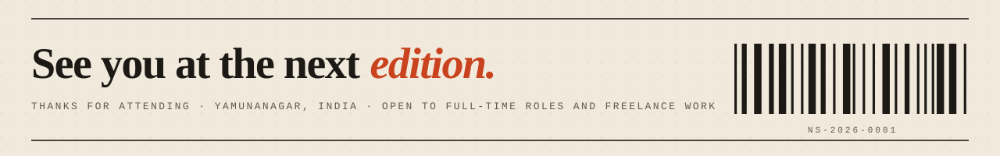


</div>
